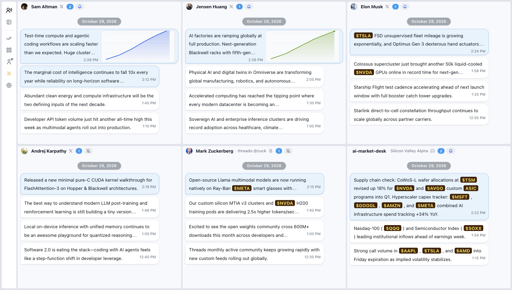

# TheySay

**All the voices you follow—on one screen, in real time.**  
Stop jumping between endless browser tabs and apps. **TheySay** brings your favorite **X (Twitter)** accounts, **Threads** creators, and **Discord** channels together into a single, customizable desktop dashboard.

**在一个界面，实时追踪你关注的所有声音。**  
告别在无数浏览器标签页与软件之间来回切换。**TheySay** 将你关注的 **X (Twitter)** 博主、**Threads** 创作者与 **Discord** 频道汇聚在同一块桌面看板上，重要动态一目了然。

## Download / 下载安装

Download the latest installer for **macOS**, **Windows**, or **Linux** from **[GitHub Releases](https://github.com/laike9m/TheySay/releases/latest)**.

前往 **[GitHub Releases](https://github.com/laike9m/TheySay/releases/latest)** 下载适用于 **macOS**、**Windows** 或 **Linux** 的最新安装包。

## Highlights / 核心亮点

- **One Screen for Every Account (`1×1` to `4×4` Layouts)**: Watch real-time updates from multiple followed accounts side by side in a single view. Choose any grid layout from `1×1` up to `4×4`, freely drag and resize cards to spotlight key feeds, and type any username to quickly add accounts across X and Threads—or paste a link to follow any public or private Discord channel.

  **一屏纵览多账号动态（支持 `1×1` 至 `4×4` 布局）**：在一个界面内同时查看多个关注账号的实时更新。支持从 `1×1` 到 `4×4` 的灵活网格布局，卡片可自由拖拽与调整大小；直接输入用户名即可添加 X 或 Threads 账号，粘贴链接即可追踪任意公开或私有 Discord 频道。

- **Distraction-Free Chat-Style Reading**: Updates appear in clean, chronological chat bubbles instead of cluttered social media timelines. Web links automatically display readable page titles, images sit neatly beside the text, and clicking any message opens the full post, quoted thread, or high-resolution media in a focused popup reader.

  **清爽的对话流阅读体验**：告别杂乱的信息流广告与算法干扰，所有动态均以清爽的时间流对话气泡呈现。网页链接自动显示文章标题，配图与文字紧凑排布；点击任意气泡即可弹出阅读卡片，随时查看完整长文、引用内容或高清大图。

- **Built for Market & Tech Watchers**: Automatically recognizes and highlights US stock, ETF, and crypto tickers (such as `$NVDA`, `$TSLA`, `$BTC`) with customizable badge colors so market-moving mentions stand out at a glance. Want less noise? Add mute keywords or phrases in Settings to hide unwanted topics automatically.

  **为市场与科技追踪打造**：自动识别并高亮消息中的美股、ETF 与加密货币代码（如 `$NVDA`、`$TSLA`、`$BTC`），支持自定义高亮配色，让你一眼捕捉关键标的；同时支持在设置中添加屏蔽词或短语，自动过滤噪音信息。

- **Never Miss an Update**: Unread counters on each card and on your system Dock / taskbar icon show exactly where new posts have arrived. Enable desktop notifications only for your highest-priority accounts while keeping the rest silent, or clear everything with a single click.

  **重要消息不再遗漏**：每张卡片与系统 Dock / 任务栏图标均会实时显示未读消息数量。你可以只为最核心的账号开启桌面弹窗通知、将其他频道保持静默，也可以随时一键全部标为已读。

- **Personalized & Portable**: Switch effortlessly between Light and Dark themes, customize card and bubble colors, set independent auto-refresh intervals for each platform, receive automatic cross-platform version updates from GitHub Releases, and export or import your entire dashboard layout and followed list as a `.json` backup file anytime.

  **个性化外观与一键备份**：支持浅色与深色模式一键切换，可自由定制卡片背景与气泡配色，并为不同平台单独设置自动刷新频率；支持基于 GitHub Releases 的全平台自动版本检测与一键更新，并可将所有关注列表、排版与偏好设置一键导出为 `.json` 文件，跨设备迁移轻而易举。

## Quick Start / 快速上手

1. **Connect Your Accounts**: Use the left sidebar to sign in to X, Threads, or Discord (your session stays local on your device).

   **登录平台账号**：在左侧边栏点击对应图标登录 X、Threads 或 Discord（登录状态仅保存在本地设备）。

2. **Set Up Your Grid**: Pick a layout from `1×1` to `4×4` in the sidebar, then click any card header to enter an `@handle` or Discord channel link.

   **配置监控面板**：在左侧切换 `1×1` 至 `4×4` 网格布局，点击任意卡片顶部输入 `@用户名` 或粘贴 Discord 频道链接。

3. **Customize Your Workflow**: Click the bell icon on any card to toggle desktop notifications, or open **Settings** to adjust refresh intervals, ticker colors, language (`English` / `中文`), and keyword filters.

   **定制专属工作流**：点击卡片右上角铃铛图标单独开启桌面通知，或打开 **设置** 调整刷新频率、股票代码配色、界面语言（`中文` / `English`）与屏蔽词。
